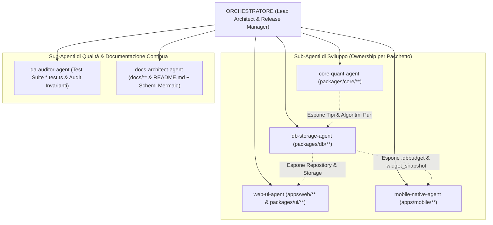
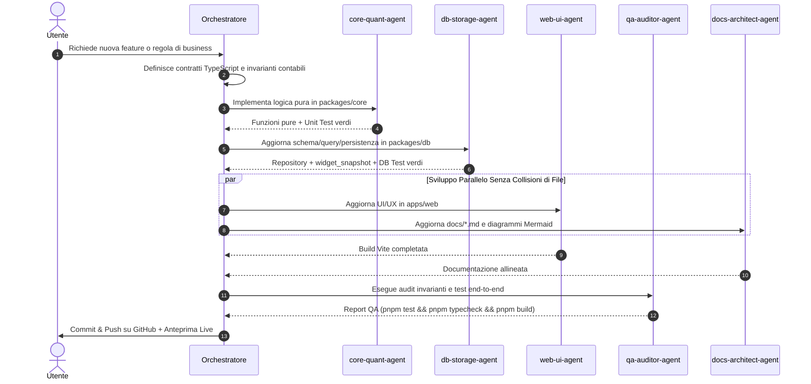
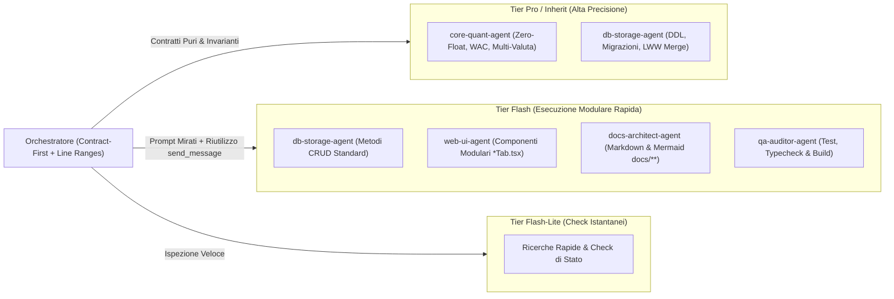

# Architettura Multi-Agente: Orchestratore & 6 Sub-Agenti (DailyBudget)

Questo documento definisce la topologia dell'**Orchestratore** e dei **6 Sub-Agenti specializzati** registrati per lo sviluppo parallelo e sicuro del monorepo **DailyBudget** (`Turborepo` + `pnpm`).

---

## 1. Topologia Multi-Agente e Ownership Disgiunta (`flowchart`)

Poiché il monorepo risiede in un workspace condiviso (`inherit`), l'architettura assegna ad ogni sub-agente una **cartella esclusiva (Zero-Collision Ownership)**:

---

## 2. Pipeline di Esecuzione di una Feature (`sequenceDiagram`)

---

## 3. Schede dei 6 Sub-Agenti Registrati

### 1. `core-quant-agent` — *Financial & Crypto Core Engine Specialist*
- **Ownership**: `packages/core/**`
- **Responsabilità**: Algoritmi matematici puri (`doesTransactionAffectBudget`, `calculateDailyBudget`, `calculateTricountSettlements`, `calculateCryptoAssetMetrics`, `computeTricountExpenseSplits`, conversioni multi-valuta a 3 livelli, motore `recurring_rules`).
- **Vincolo Ferreo**: Zero dipendenze esterne; importi Fiat esclusivamente in `integer cents`; quantità Crypto in stringhe decimali.

### 2. `db-storage-agent` — *SQLite-Wasm, OPFS & Sync Specialist*
- **Ownership**: `packages/db/**`
- **Responsabilità**: Gestione DDL/migrazioni `schema_v2.sql`, formato binario `.dbbudget` (`SQLite format 3\0`), persistenza ibrida `OPFS` + `File System Access API`, ricalcolo atomico di `accounts.cached_balance` e `widget_snapshot` (`id = 'current'`), adapter API Frankfurter/CoinGecko offline-first.

### 3. `web-ui-agent` — *Frontend, Design System & Accessibility Specialist*
- **Ownership**: `apps/web/**`, `packages/ui/**`
- **Responsabilità**: Viste React + Vite, Design System Light/Dark, numeri tabulari (`tabular-nums`), accessibilità WCAG/ARIA, distinzione visiva tra `base_amount` (Cashflow) e `budget_base_amount` (Competenza Budget).

### 4. `mobile-native-agent` — *Expo, WidgetKit, WatchOS, Glance & Wear OS Specialist*
- **Ownership**: `apps/mobile/**`
- **Responsabilità**: App React Native + Expo Prebuild (CNG) e target nativi Swift/Kotlin che leggono direttamente `SELECT * FROM widget_snapshot WHERE id = 'current'` dal file `.dbbudget` in App Group / Shared Storage in $O(1)$.

### 5. `qa-auditor-agent` — *Accounting Invariants & Edge-Case Auditor*
- **Ownership**: Trasversale (`*.test.ts`)
- **Responsabilità**: Audit e test end-to-end su resti dispari (`100€ / 3`), priorità `Transazione > Conto`, allineamento `sum(transaction_splits) == budget_base_amount`, PMC post-staking a costo zero e validità binaria `.dbbudget`.

### 6. `docs-architect-agent` — *Documentation, Product Analysis & Mermaid Diagrams Specialist*
- **Ownership**: `docs/**` e `README.md`
- **Responsabilità**: Mantenere sempre sincronizzata la suite documentale (`ARCHITECTURE.md`, `PRODUCT_ANALYSIS.md`, `DATABASE_SCHEMA.md`, `AGENTS_ARCHITECTURE.md`, `README.md`) corredata da diagrammi Mermaid (`flowchart`, `sequenceDiagram`, `erDiagram`, `stateDiagram-v2`) ad ogni evoluzione dello schema o delle regole di business.

---

## 4. Strategia di Ottimizzazione Token & Routing dei Modelli

Per massimizzare la velocità di esecuzione e ridurre drasticamente il consumo di token di I/O senza sacrificare il rigore contabile, l'Orchestratore applica **4 regole architetturali di ottimizzazione**:

### Le 4 Regole di Risparmio Token Attive

| # | Regola di Ottimizzazione | Strategia Tecnica & Configurazione | Impatto sul Consumo Token |
| :--- | :--- | :--- | :--- |
| **1** | **Matrice di Routing dei Modelli per Ruolo (`Model` Tiering)** | • `core-quant-agent`: `inherit` / `pro` (massima precisione per calcoli contabili Zero-Float, WAC e multi-valuta). • `db-storage-agent`: `inherit` / `pro` per DDL/migrazioni/LWW Merge; `flash` per metodi CRUD standard. • `web-ui-agent`: `flash` (costruzione e aggiornamento componenti React modulari su contratti TypeScript già definiti). • `docs-architect-agent`: `flash` (aggiornamento documentazione Markdown e diagrammi Mermaid in `docs/**`). • `qa-auditor-agent`: `flash` (esecuzione pipeline `pnpm test && pnpm typecheck && pnpm build` e verifica invarianti). • Ricerche rapide / Check di stato: `flash_lite`. | Riserva i modelli `pro` esclusivamente al ragionamento matematico/SQL complesso, delegando fino all'80% dei task operativi a `flash` e `flash_lite`. |
| **2** | **Riutilizzo del Contesto via `send_message`** | Per task successivi nello stesso dominio, l'Orchestratore invia istruzioni al `conversationId` del sub-agente già attivo tramite `send_message` anziché istanziarne uno nuovo da zero, evitando di rileggere i file del pacchetto. | Azzera il costo di cold-start e di rilettura ripetuta dei sorgenti del pacchetto. |
| **3** | **Partizionamento Modulare dei File UI (`apps/web/src/components/*Tab.tsx`)** | Ogni vista della WebApp risiede in un componente dedicato (`DashboardTab.tsx`, `TransactionsTab.tsx`, `TricountTab.tsx`, `LoansTab.tsx`, `CryptoTab.tsx`, `PersistenceHeader.tsx`), permettendo a `web-ui-agent` di leggere e modificare ~200–400 righe invece di un file monolitico da >3.500 righe. | **Risparmio 5x–8x** sui token di I/O ad ogni iterazione UI. |
| **4** | **Prompt Contract-First con Line Ranges (`StartLine`/`EndLine`)** | L'Orchestratore fornisce nel prompt le firme TypeScript esatte e i range di righe mirati (`StartLine`/`EndLine`), evitando scansioni esplorative dell'intero repository da parte dei sub-agenti. | Elimina letture ridondanti e garantisce modifiche chirurgiche al primo colpo. |

