# Architettura di Sistema — DailyBudget

**DailyBudget** è progettato secondo un paradigma **100% Local-First e Privacy-First**: l'intero stato finanziario dell'utente risiede in un singolo file database SQLite3 portatile con estensione `.dbbudget`. Non è richiesto alcun backend proprietario per il funzionamento core.

---

## 1. Topologia del Monorepo (`Turborepo` + `pnpm`)

Il codice è organizzato in pacchetti disaccoppiati dove la logica matematica e contabile (`@dailybudget/core`) non ha alcuna dipendenza da piattaforma, UI o storage.

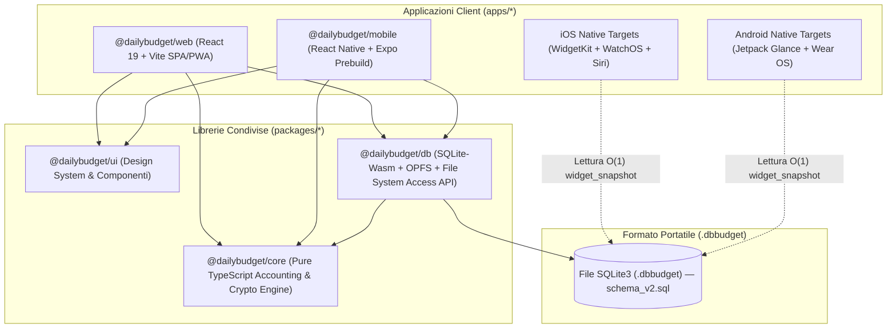

---

## 2. Pipeline di Persistenza Locale su Web (`SQLite-Wasm` + `OPFS` + `File System Access API`)

Nel browser, `@dailybudget/db` mantiene una pipeline a **3 livelli sincronizzati** che garantisce velocità in-memory, persistenza automatica trasparente (senza popup ad ogni click) e scrittura diretta sul file `.dbbudget` presente sul disco locale dell'utente.

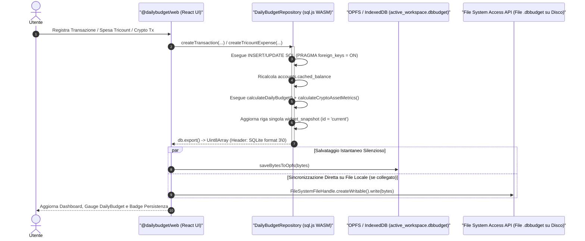

### Compatibilità Multi-Browser del File Manager
| Funzionalità | Browser Chromium (Chrome, Edge, Brave) | Safari / Firefox / Mobile Browser |
| :--- | :--- | :--- |
| **Motore SQL** | `SQLite-Wasm` (`sql.js` WebAssembly locale) | `SQLite-Wasm` (`sql.js` WebAssembly locale) |
| **Auto-Save ad ogni mutazione** | `OPFS` (`navigator.storage.getDirectory()`) | `OPFS` con fallback trasparente su `IndexedDB` |
| **Apertura file `.dbbudget`** | `window.showOpenFilePicker()` (mantiene handle vivo) | `<input type="file" accept=".dbbudget,.sqlite,.db">` |
| **Salvataggio su disco utente** | Scrittura diretta su `FileSystemFileHandle` collegato | `window.showSaveFilePicker()` o download `.dbbudget` |

---

## 3. Architettura Mobile, Widget e Smartwatch (`widget_snapshot`)

Su iOS e Android i widget della Home Screen e le complicazioni per Smartwatch hanno limiti severi di memoria e tempo di CPU: **non possono avviare il runtime JavaScript di React Native** solo per mostrare quanto budget resta oggi.

Per risolvere questo problema alla radice, ogni mutazione effettuata nel database aggiorna atomicamente la tabella a riga singola `widget_snapshot` (`id = 'current'`).

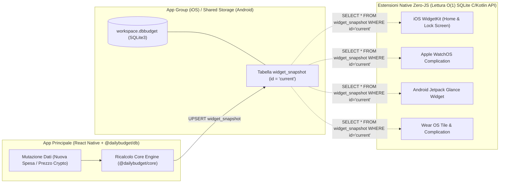

---

## 4. Sincronizzazione Offline-First Tassi Fiat & Prezzi Crypto (`market-sync`)

Il servizio di sincronizzazione di mercato aggiorna i cambi valutari Fiat e le quotazioni Crypto preservando l'architettura **100% Offline-First e Privacy-First**:

- **Fonti Pubbliche Senza Chiave API**: la WebApp interroga on-demand o all'avvio **Frankfurter API** (tassi di cambio BCE per le valute Fiat) e **CoinGecko API** (prezzi spot per gli asset Crypto configurati con `coingecko_id`).
- **Cache Persistente nel File `.dbbudget`**: ogni tasso o prezzo scaricato viene salvato immediatamente nelle tabelle SQLite `exchange_rates` e `crypto_assets` (`last_price_Cents`, `last_price_updated_at`), diventando parte integrante del file `.dbbudget`.
- **Fallback Deterministico al 100%**: se il dispositivo è offline, sotto rete restrittiva o le API pubbliche non rispondono, il servizio intercetta silenziosamente l'errore di rete e utilizza i tassi e prezzi già presenti in cache dentro `.dbbudget` senza bloccare alcuna operazione contabile.

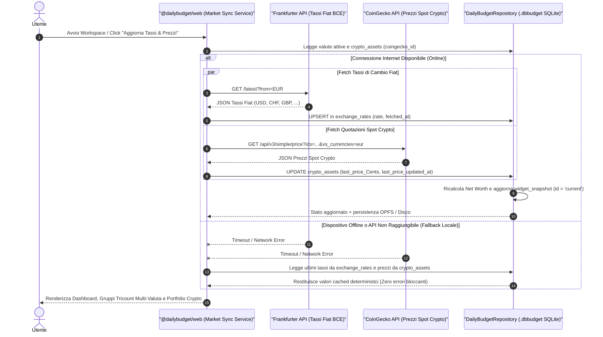

---

## 5. Strategia Ibrida Smart per Allegati e Scontrini (`attachments`)

La tabella `attachments` utilizza una strategia di archiviazione ibrida progettata per mantenere il file `.dbbudget` auto-contenuto senza mai superare il limite rigido di **~30 MB di RAM delle estensioni iOS WidgetKit**:

1. **Compressione Client-Side Automatica**: quando l'utente allega la foto di uno scontrino o una ricevuta (`image/jpeg`, `image/png`, `image/webp`), il client ridimensiona l'immagine (lato massimo `<= 1200px`) e la comprime in formato **WebP/JPEG** (`quality ~0.75`), riducendo una foto da 4–8 MB a circa **`40–80 KB`**.
2. **Soglia Smart `500 KB` (`MAX_INLINE_BLOB_BYTES = 512000`)**:
   - **Se `file_size_bytes <= 500 KB`** (99% degli scontrini compressi): l'allegato viene salvato direttamente dentro il file `.dbbudget` come `storage_type = 'inline_blob'` (`data_blob BLOB`), garantendo portabilità immediata su tutti i dispositivi.
   - **Se `file_size_bytes > 500 KB`** (es. contratti PDF multipagina o fatture pesanti): il database rifiuta il salvataggio inline per proteggere la memoria del Widget e registra un riferimento esterno con `storage_type = 'local_path'` (file nella cartella allegati locale) oppure `storage_type = 'cloud_url'`.

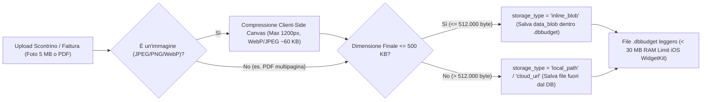

---

## 6. Sincronizzazione Multi-Dispositivo & Row-Level LWW Merge (`.dbbudget` & Delta JSON)

Poiché un file SQLite binario sincronizzato tramite cartelle cloud (iCloud Drive, Google Drive, Syncthing) può generare copie in conflitto se modificato offline su due dispositivi contemporaneamente (es. Laptop + Smartphone), `@dailybudget/db` implementa un motore di **Row-Level Last-Write-Wins (LWW) Merge** deterministico e senza perdita di dati:

- **Chiave di Risoluzione `(id, updated_at, is_deleted)`**: tutte le tabelle sincronizzabili espongono `id` (UUID), `updated_at` (timestamp ISO-8601 UTC) e `is_deleted` (`0 | 1` soft-delete / tombstone).
- **Unione Deterministica Riga per Riga**:
  - Se un `id` esiste nel database remoto ma non in quello locale $\rightarrow$ viene **inserito** (`INSERT`).
  - Se un `id` esiste in entrambi i database $\rightarrow$ vince la riga con `remote.updated_at > local.updated_at` (`UPDATE`), propagando anche eventuali cancellazioni (`is_deleted = 1`).
- **Supporto Doppio Formato**: il merge accetta sia un secondo file binario `.dbbudget` completo (`mergeFromDatabaseBytes`) sia un pacchetto leggero **Delta JSON** (`exportDeltaSince(sinceIso)` / `mergeDeltaPacket(packet)`).
- **Riconciliazione Post-Merge**: al termine dell'unione di tutte le tabelle in una singola transazione atomica, il repository invoca `recomputeAccountBalance()` su ogni conto e `recomputeWidgetSnapshot()` per riallineare saldi, DailyBudget e Net Worth.

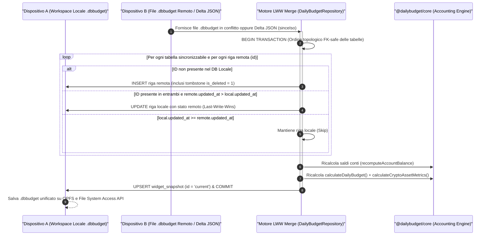

---

## 7. Pipeline Import/Export CSV Bancario con Deduplica (`computeTransactionDedupeKey`)

Per agevolare la migrazione da altre app o l'importazione periodica degli estratti conto bancari (Revolut, Fineco, Intesa, BBVA, N26), `@dailybudget/core` e `@dailybudget/db` forniscono una pipeline CSV deterministica con prevenzione dei duplicati:

1. **Parsing & Normalizzazione (`parseBankCsvTransactions`)**:
   - Supporta delimitatori `,` e `;`, campi quotati e formati numerici sia europei (`-1.234,56` / `-12,50`) sia anglosassoni (`-1234.56`), convertendoli direttamente in **interi in centesimi (`amountCents`)** senza errori floating-point.
   - Normalizza le date (`YYYY-MM-DD`, `DD/MM/YYYY`, `DD-MM-YYYY`) nello standard ISO `YYYY-MM-DD`.
2. **Impronta di Deduplica (`computeTransactionDedupeKey`)**:
   - Calcola una chiave canonica `dedupeKey` basata su `(account_id, tx_date, signed_amount_cents, normalized_merchant_or_description)`.
   - Durante l'importazione (`importBankCsvTransactions`), ogni riga CSV viene confrontata con le chiavi già presenti nel database e nel batch corrente: le righe già registrate manualmente o in un import precedente vengono **scartate automaticamente** (`skippedDuplicates`), evitando doppi addebiti sul conto e sul DailyBudget.

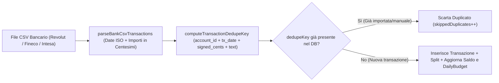

---

## 8. Architettura UI & Layout Semantico WebApp (`View Mode`, Bottom Nav & Split-View)

La WebApp di DailyBudget (`apps/web`) adotta un'architettura di presentazione reattiva a componenti orientata all'ergonomia mobile-first e alla produttività desktop. Il layout supera i tradizionali approcci rigidi a griglia a favore di una gerarchia semantica a **pannelli affiancati (`multi-pane`) e split-view**, governata da un motore unificato di **View Mode**.

### 8.1 Motore di Selezione View Mode (`Auto`, `Mobile`, `Desktop`)

L'applicazione consente sia il rilevamento automatico del dispositivo sia la forzatura esplicita da parte dell'utente tramite il selettore integrato nella sezione "Visualizzazione & Tema" del Menu unificato in alto a destra (`PersistenceHeader`), con persistenza in `localStorage` (`dailybudget_view_mode`):

- **Auto (📱🖥️)**: Rileva dinamicamente la larghezza del viewport (`window.innerWidth` con breakpoint a `860px`). Se la finestra è inferiore a `860px`, attiva la modalità Mobile; altrimenti abilita l'esperienza Desktop completa.
- **Mobile (📱 - `data-view-mode="mobile"`)**: Forza le proporzioni verticali smartphone (`max-width: 480px`), centrando il viewport anche su monitor widescreen per offrire un'interfaccia compatta e maneggevole. Sostituisce la barra superiore con la **Bottom Navigation Bar** fissa a sole icone e aggiunge la barra dedicata `mobile-reference-bar` per la data di simulazione.
- **Desktop (🖥️ - `data-view-mode="desktop"`)**: Espande il contenitore principale fino a `1440px`, visualizzando la barra superiore di navigazione a schede orizzontali (`nav-strip`) e attivando la disposizione affiancata multi-pannello a schermo intero.

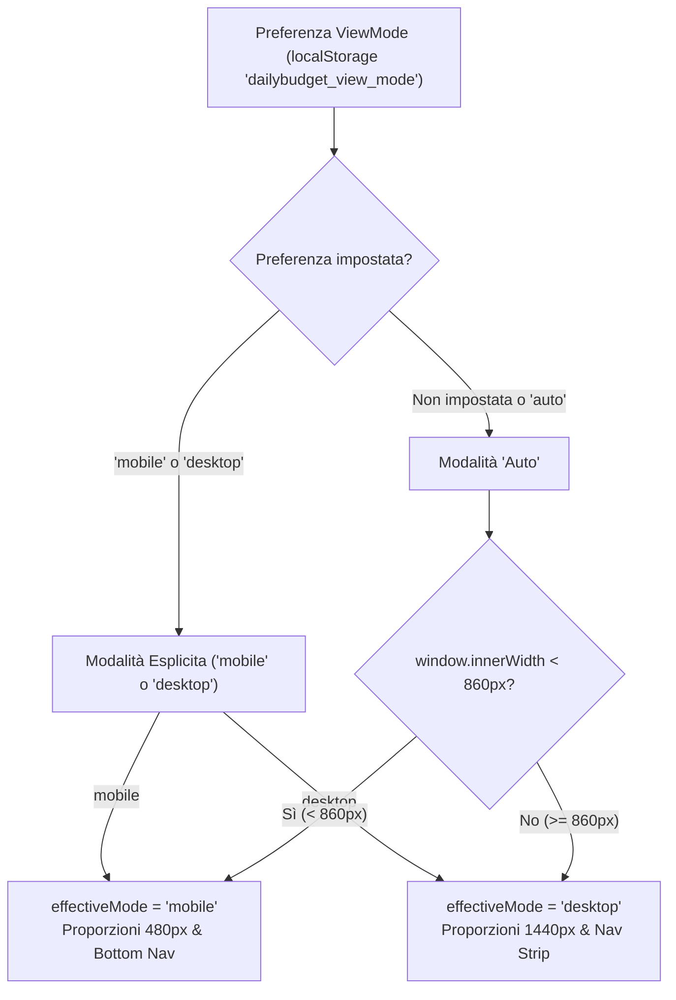

### 8.2 Navigazione Adattiva: Desktop Nav-Strip vs Mobile Bottom Nav

La navigazione tra i moduli si adatta per ottimizzare la portata del pollice su smartphone e la densità informativa su grandi schermi:

1. **Desktop Nav-Strip (Superiore)**:
   - Posizionata sotto la barra di persistenza con schede orizzontali complete.
   - Mostra icone Lucide, etichette testuali descrittive e conteggi elementi in tempo reale (es. `Conti, Split & Transazioni (18)`).
   - Include il selettore integrato della data di simulazione contabile.
2. **Mobile Bottom Navigation Bar (Inferiore, Fissa a Sole Icone)**:
   - Ancorata al fondo dello schermo (`position: fixed; bottom: 0; height: 58px; z-index: 50`) con gestione dell'area sicura iOS (`env(safe-area-inset-bottom)`).
   - Composta da pulsanti touch a sole icone (`48x44px`) conformi agli standard ergonomici di tocco.
   - Indicatori visivi dot badge (`bottom-nav-dot`) che notificano la presenza di entità caricate nei moduli Transazioni, Tricount, Prestiti e Crypto.
   - Quando visualizzata in modalità Mobile su display desktop ampi, la barra inferiore rimane centrata e vincolata alla larghezza del frame smartphone (`max-width: 480px; left: 50%; transform: translateX(-50%)`).
   - Gestione della data di simulazione tramite barra secondaria dedicata (`mobile-reference-bar`).

### 8.3 Pattern Semantico di Layout: Pannelli e Split-View

La composizione visiva dell'interfaccia adotta un modello semantico a **pannelli funzionali**, superando la vecchia terminologia a griglie e colonne generiche:

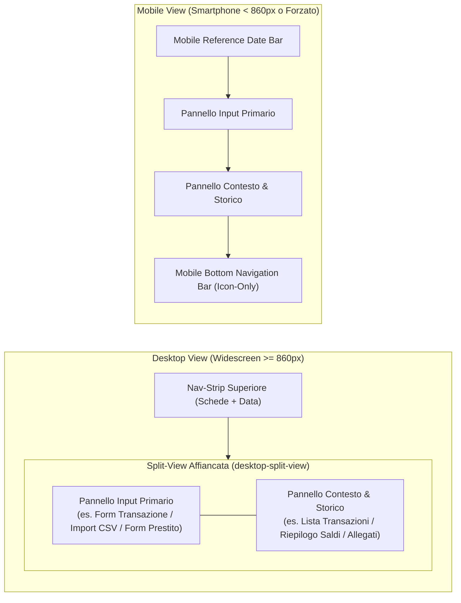

- **`.desktop-multi-pane`**: Layout asimmetrico per la Dashboard principale (`1.35fr 1fr`). Affianca il pannello eroe del DailyBudget (`daily-hero`) con il pannello informativo dello snapshot nativo e del patrimonio netto.
- **`.desktop-split-view`**: Layout a divisione funzionale (`minmax(360px, 1fr) minmax(460px, 1.4fr)`). Mantiene visibile e accessibile il pannello di immissione/configurazione a sinistra mentre visualizza contestualmente i dati elaborati o lo storico a destra (utilizzato nei moduli Transazioni, Tricount, Prestiti e Crypto).
- **`.panel-pair`**: Suddivisione paritetica a due pannelli (`repeat(2, minmax(0, 1fr))`) per sezioni di uguale rilevanza visiva (es. Pannello Importazione Estratto Conto CSV vs Pannello Scontrini e Ricevute Ibridi).
- **`.metric-tile-group`**: Raggruppamento semantico per tessere metriche e indicatori KPI (`repeat(4, minmax(0, 1fr))` su schermi ampi, responsive su mobile a 2 o 1 pannello).
- **Collasso Reattivo Unificato**: In modalità Mobile (`data-view-mode="mobile"` o viewport `< 860px`), tutti i pannelli multi-pane, split-view e panel-pair collassano a colonna singola a scorrimento verticale (`1fr`), garantendo un'ergonomia lineare priva di scroll orizzontali indesiderati.

---

### 8.4 Architettura Header: Brand Cluster & Menu Unificato Top-Right

La testata superiore (`PersistenceHeader.tsx`) unifica le azioni di controllo del database e le preferenze globali in un layout simmetrico ed ergonomico, eliminando la dispersione dei pulsanti operativi lungo la testata:

1. **Brand Cluster (in alto a sinistra)**:
   - **Logo Applicativo Vettoriale**: componente [`DailyBudgetAppIcon`](file:///home/antigravity/Yhtnay/DailyBudget/apps/web/src/components/DailyBudgetAppIcon.tsx) (`34px` su Desktop, `28px` su Mobile) che rimpiazza il vecchio riquadro statico "DB".
   - **Tipografia di Brand**: Titolo *DailyBudget* con badge pillola di release (`v0.2.0`) e sottotitolo tecnico dell'architettura (*SQLite-Wasm • OPFS • File System Access API*).
   - **Indicatore di Stato del File (`.file-pill`)**: Badge in tempo reale che mostra il nome del file SQLite `.dbbudget`, dimensione in KB, backend di persistenza attivo (`DISK-SYNC`, `opfs` o `memory`) e il dot verde di sincronizzazione su filesystem.
2. **Menu Unificato Dropdown (in alto a destra, alla stessa altezza del Brand)**:
   - Pulsante trigger con icona `<Menu />`, etichetta su desktop e freccia animata `<ChevronDown />`.
   - Pannello a comparsa (`.header-dropdown-menu`, `role="menu"`) con chiusura automatica su selezione, tasto Escape e click esterno.

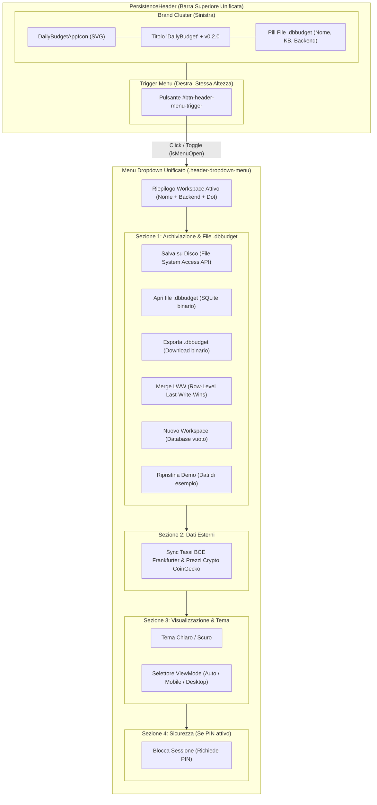

---

### 8.5 Brand Identity, Iconografia SVG & Pipeline Asset PWA

DailyBudget implementa un'identità grafica coordinata, progettata per garantire leggibilità a qualsiasi scala (dalla favicon a 16px fino all'icona PWA a 512px e allo splash screen di sistema):

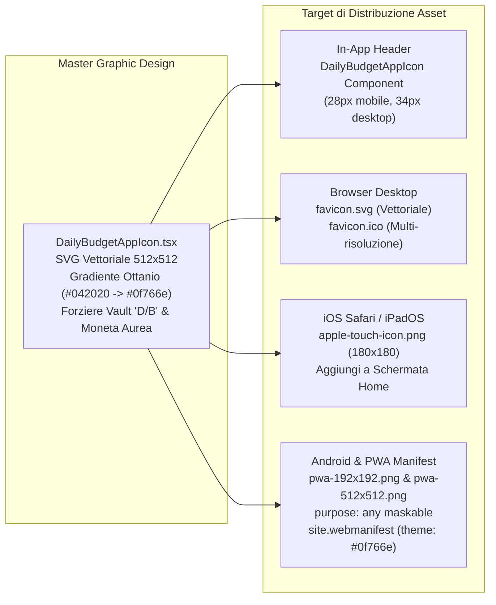

- **Icona Vettoriale (`DailyBudgetAppIcon.tsx`)**:
  - Risoluzione geometrica nativa a `512x512` con `viewBox="0 0 512 512"`.
  - Base a super-ellisse smussata (`rx="116"`, `ry="116"`) con gradiente lineare ottanio-smeraldo (`#042020` -> `#0d5952` -> `#0f766e`) e bagliore radiale d'accento teal (`#2dd4bf`).
  - Monogramma a forziere (*Vault "D/B"*) rifinito con doppia campitura e ombra di profondità, affiancato da una moneta dorata con finitura a stella a 4 punte.
  - Supporto per rendering accessibile con attributi `role="img"` e `aria-label`.
- **Bundle Asset Pubblici (`apps/web/public/`)**:
  - `favicon.svg`: rendering SVG nitido e privo di sfocature nei browser moderni (Chrome, Safari, Firefox, Edge).
  - `favicon.ico`: icona multi-livello per compatibilità universale.
  - `apple-touch-icon.png`: formato quadrato 180x180 px per la generazione dell'icona nativa su iOS Safari quando l'utente seleziona *"Aggiungi a schermata Home"*.
  - `pwa-192x192.png` e `pwa-512x512.png`: icone PWA ad alta densità con metadato `"purpose": "any maskable"`, compatibili con i ritagli circolari, a goccia o quadrati dei launcher Android.
  - `site.webmanifest`: file di manifesto conforme alle specifiche W3C Web App Manifest con nome completo, `display: "standalone"`, `orientation: "portrait-primary"`, `theme_color: "#0f766e"` e `background_color: "#042020"`.
- **Meta-Tag HTML (`apps/web/index.html`)**:
  - Tag `<meta name="theme-color" content="#0f766e" />` per colorare la barra di stato dei browser mobile.
  - Tag `<meta name="apple-mobile-web-app-capable" content="yes" />` e `<meta name="apple-mobile-web-app-status-bar-style" content="black-translucent" />` per un'esperienza a schermo intero priva di barre URL su iOS.

