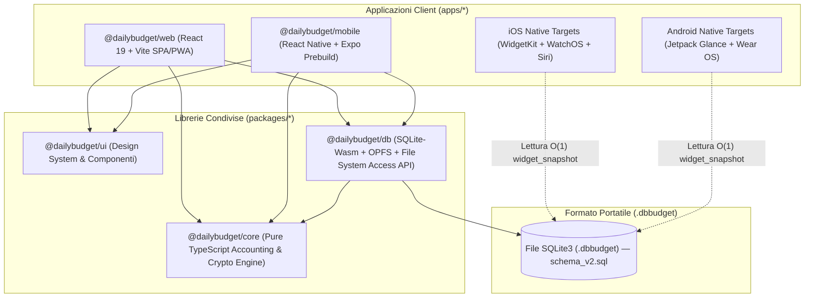
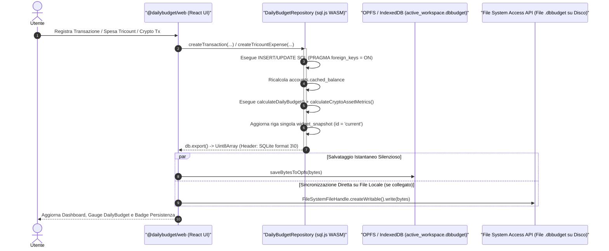
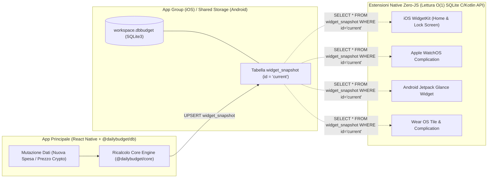
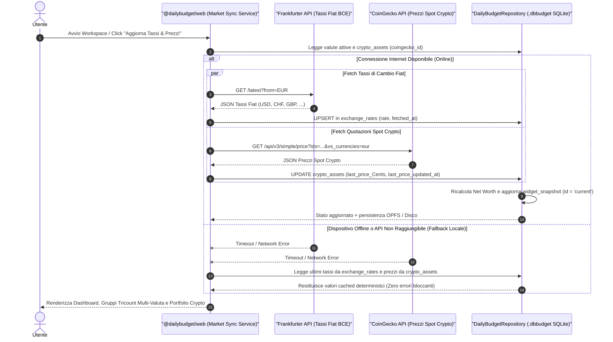

# Architettura di Sistema — DailyBudget

**DailyBudget** è progettato secondo un paradigma **100% Local-First e Privacy-First**: l'intero stato finanziario dell'utente risiede in un singolo file database SQLite3 portatile con estensione `.dbbudget`. Non è richiesto alcun backend proprietario per il funzionamento core.

---

## 1. Topologia del Monorepo (`Turborepo` + `pnpm`)

Il codice è organizzato in pacchetti disaccoppiati dove la logica matematica e contabile (`@dailybudget/core`) non ha alcuna dipendenza da piattaforma, UI o storage.

---

## 2. Pipeline di Persistenza Locale su Web (`SQLite-Wasm` + `OPFS` + `File System Access API`)

Nel browser, `@dailybudget/db` mantiene una pipeline a **3 livelli sincronizzati** che garantisce velocità in-memory, persistenza automatica trasparente (senza popup ad ogni click) e scrittura diretta sul file `.dbbudget` presente sul disco locale dell'utente.

### Compatibilità Multi-Browser del File Manager
| Funzionalità | Browser Chromium (Chrome, Edge, Brave) | Safari / Firefox / Mobile Browser |
| :--- | :--- | :--- |
| **Motore SQL** | `SQLite-Wasm` (`sql.js` WebAssembly locale) | `SQLite-Wasm` (`sql.js` WebAssembly locale) |
| **Auto-Save ad ogni mutazione** | `OPFS` (`navigator.storage.getDirectory()`) | `OPFS` con fallback trasparente su `IndexedDB` |
| **Apertura file `.dbbudget`** | `window.showOpenFilePicker()` (mantiene handle vivo) | `<input type="file" accept=".dbbudget,.sqlite,.db">` |
| **Salvataggio su disco utente** | Scrittura diretta su `FileSystemFileHandle` collegato | `window.showSaveFilePicker()` o download `.dbbudget` |

---

## 3. Architettura Mobile, Widget e Smartwatch (`widget_snapshot`)

Su iOS e Android i widget della Home Screen e le complicazioni per Smartwatch hanno limiti severi di memoria e tempo di CPU: **non possono avviare il runtime JavaScript di React Native** solo per mostrare quanto budget resta oggi.

Per risolvere questo problema alla radice, ogni mutazione effettuata nel database aggiorna atomicamente la tabella a riga singola `widget_snapshot` (`id = 'current'`).

---

## 4. Sincronizzazione Offline-First Tassi Fiat & Prezzi Crypto (`market-sync`)

Il servizio di sincronizzazione di mercato aggiorna i cambi valutari Fiat e le quotazioni Crypto preservando l'architettura **100% Offline-First e Privacy-First**:

- **Fonti Pubbliche Senza Chiave API**: la WebApp interroga on-demand o all'avvio **Frankfurter API** (tassi di cambio BCE per le valute Fiat) e **CoinGecko API** (prezzi spot per gli asset Crypto configurati con `coingecko_id`).
- **Cache Persistente nel File `.dbbudget`**: ogni tasso o prezzo scaricato viene salvato immediatamente nelle tabelle SQLite `exchange_rates` e `crypto_assets` (`last_price_Cents`, `last_price_updated_at`), diventando parte integrante del file `.dbbudget`.
- **Fallback Deterministico al 100%**: se il dispositivo è offline, sotto rete restrittiva o le API pubbliche non rispondono, il servizio intercetta silenziosamente l'errore di rete e utilizza i tassi e prezzi già presenti in cache dentro `.dbbudget` senza bloccare alcuna operazione contabile.

