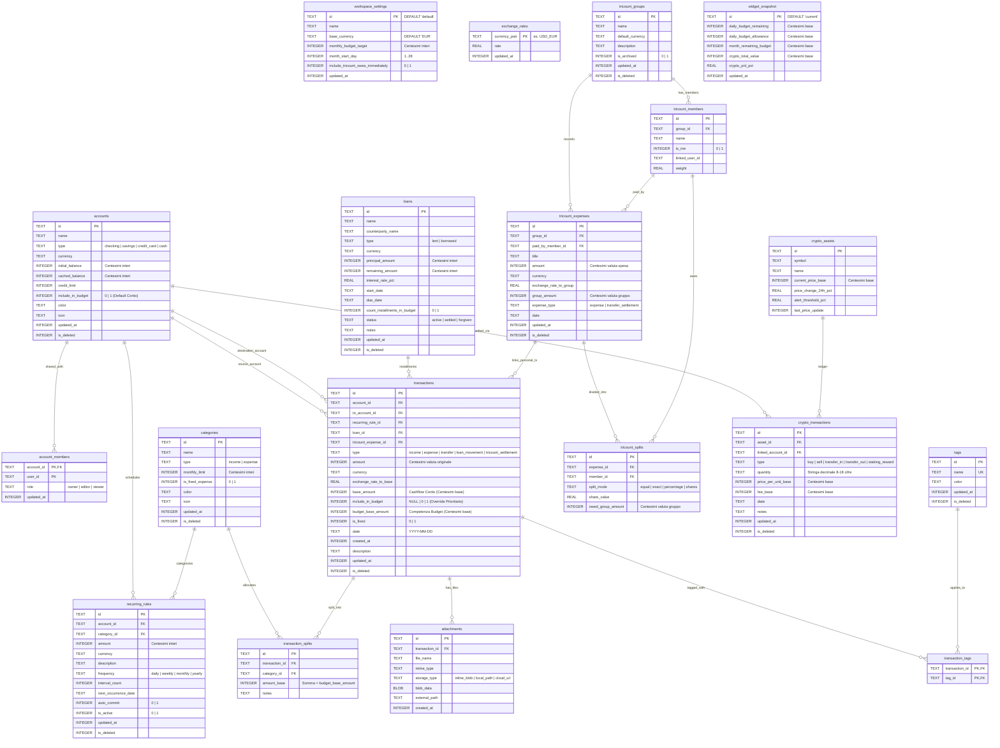

# Schema Database SQLite v2 (`.dbbudget`) — DailyBudget

Ogni file `.dbbudget` è un database **SQLite3 standard** (`SQLite format 3\0`) definito in [`packages/db/schema/schema_v2.sql`](../packages/db/schema/schema_v2.sql) e tipizzato in [`packages/db/src/schema.ts`](../packages/db/src/schema.ts).

---

## 1. Diagramma Entità-Relazione Completo (`erDiagram`)

---

## 2. Indici Parziali per Performance Query Local-First

Lo schema definisce 4 indici parziali filtrati su `WHERE is_deleted = 0` per mantenere istantanee le query di aggregazione mensile e di riconciliazione anche su file `.dbbudget` con decine di migliaia di movimenti:

| Nome Indice | Tabella e Colonna | Filtro Parziale | Scopo Principale |
| :--- | :--- | :--- | :--- |
| `idx_tx_date` | `transactions(date)` | `WHERE is_deleted = 0` | Calcolo istantaneo del mese corrente in `computeDailyBudgetForDate()` |
| `idx_tx_account` | `transactions(account_id)` | `WHERE is_deleted = 0` | Ricalcolo del saldo `cached_balance` per singolo conto |
| `idx_tx_loan` | `transactions(loan_id)` | `WHERE is_deleted = 0` | Storico rate e rimborsi associati a un prestito/debito |
| `idx_tx_tricount` | `transactions(tricount_expense_id)` | `WHERE is_deleted = 0` | Collegamento 1:1 tra spesa di gruppo Tricount e movimento sul conto personale |
