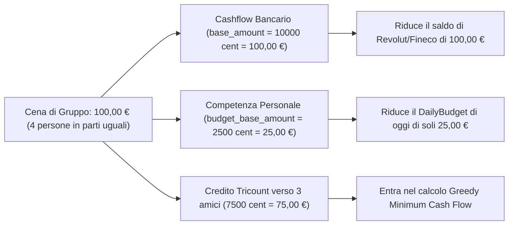
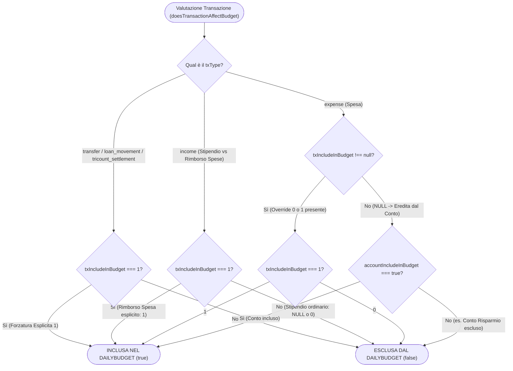
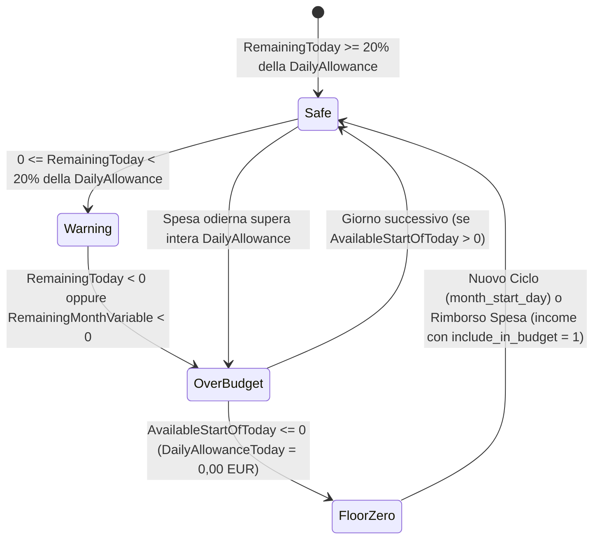
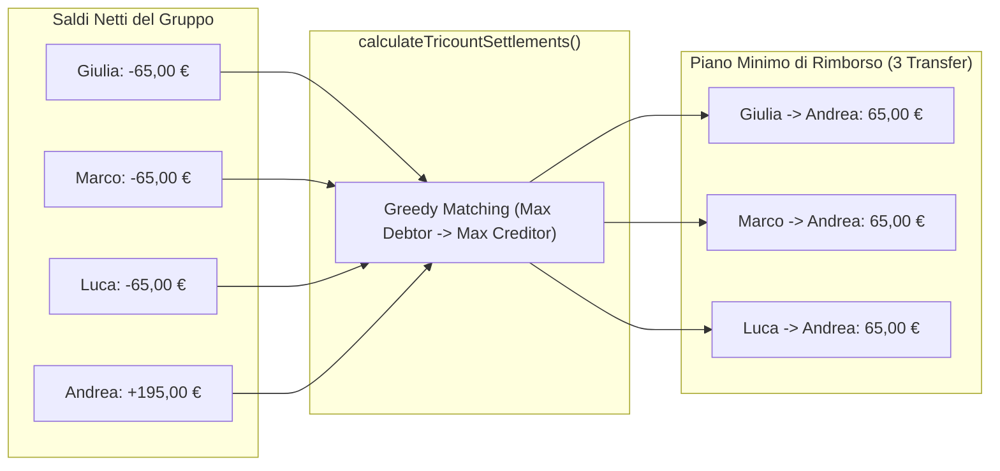
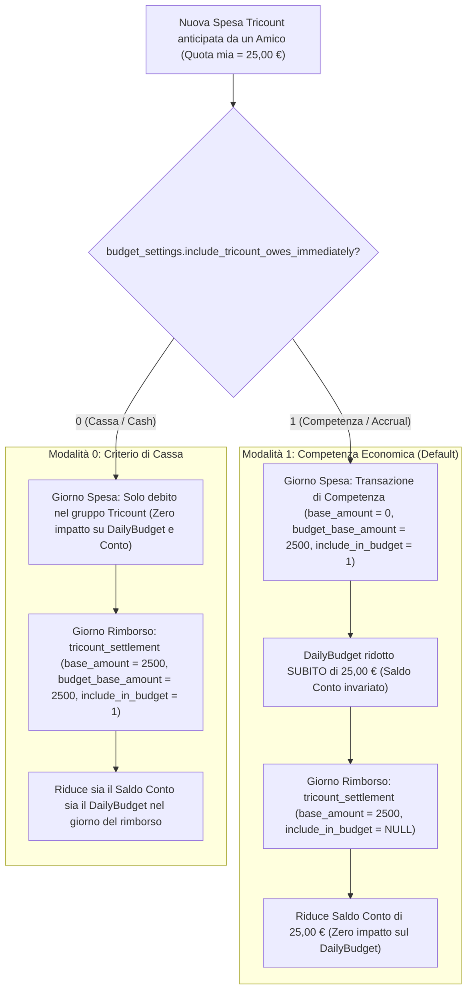
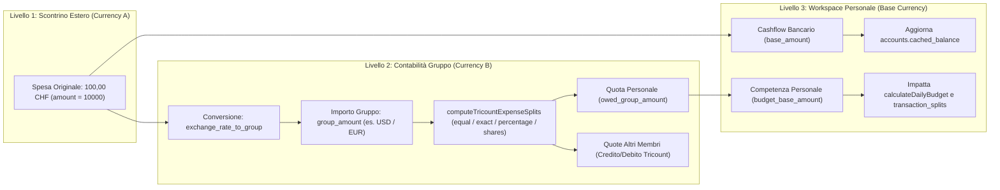
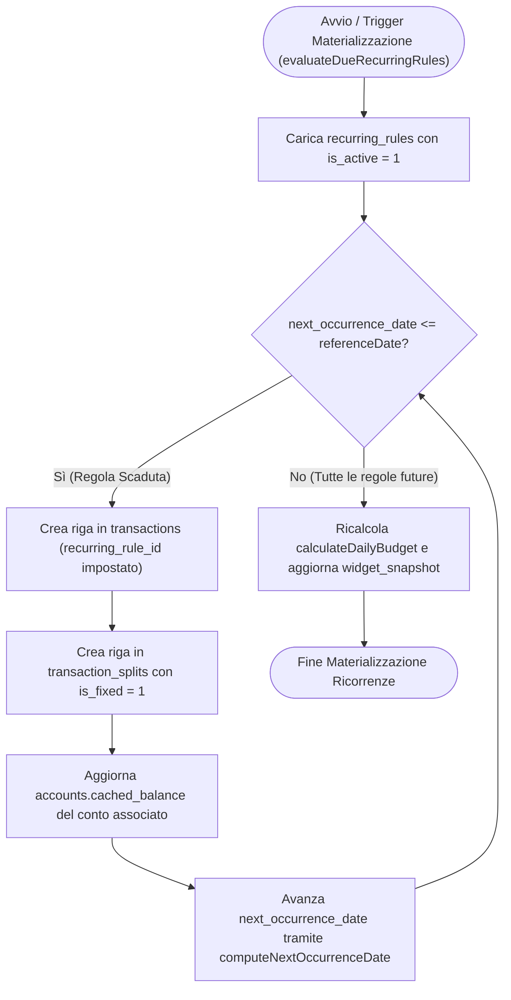

# Analisi del Prodotto & Regole di Business — DailyBudget

Questo documento descrive la logica finanziaria, gli invarianti contabili e i flussi funzionali di **DailyBudget**, implementati in [`@dailybudget/core`](../packages/core/src/index.ts).

---

## 1. Invariante Zero Floating-Point e Separazione Cashflow vs Competenza

### A. Rappresentazione Numerica
- **Valute Fiat**: tutti gli importi sono memorizzati e calcolati come **interi in centesimi (minor units)** (`12,50 €` = `1250`). Nessuna operazione contabile Fiat usa virgola mobile non arrotondata.
- **Criptovalute**: le quantità sono rappresentate come **stringhe decimali ad alta precisione** (es. `"0.04523100"`) per preservare fino a 8–18 decimali senza errori di rappresentazione IEEE 754.

### B. Cashflow Bancario (`base_amount`) vs Competenza di Budget (`budget_base_amount`)
Ogni transazione separa nettamente due grandezze:
1. **`base_amount`**: l'importo effettivo (convertito nella valuta base del workspace) che entra o esce dal saldo del conto bancario (`accounts.cached_balance`).
2. **`budget_base_amount`**: la quota parte di competenza personale che impatta il calcolo del **DailyBudget** e gli split di categoria (`transaction_splits`).

---

## 2. Gerarchia di Priorità sul Budget (`Transazione > Conto`) e Regola delle Entrate (`income`)

La funzione [`doesTransactionAffectBudget`](../packages/core/src/index.ts) decide se una transazione impatta il calcolo del DailyBudget seguendo una gerarchia deterministica:

- **Spese (`expense`)**: l'override esplicito sulla transazione (`include_in_budget: 0 | 1`) vince sempre sul default del conto (`accounts.include_in_budget`); se `include_in_budget` è `NULL`, eredita dal conto.
- **Entrate (`income`)**: gli stipendi ordinari sono già inclusi a monte nel `monthly_budget_target` di `budget_settings`. Pertanto, una transazione di tipo `income` aumenta il `VariablePool` del ciclo corrente **solo ed esclusivamente se marcata esplicitamente con `include_in_budget = 1`** (es. rimborso spese, reso merce o accredito straordinario destinato al budget quotidiano). Se `include_in_budget` è `NULL` o `0`, l'entrata aggiorna il saldo bancario (`accounts.cached_balance`) ma non gonfia il DailyBudget.
- **Movimenti Patrimoniali (`transfer`, `loan_movement`, `tricount_settlement`)**: esclusi di default dal DailyBudget, a meno che non siano forzati con `include_in_budget = 1` (es. saldo Tricount in modalità Cassa o versamento PAC incluso nel budget).

---

## 3. Motore Matematico DailyBudget, Ciclo Custom (`month_start_day`) & Sforamento

### A. Finestra del Ciclo di Budget Personalizzato (`computeBudgetCycleWindow`)
Anziché vincolare il budget al mese solare (`1..31`), la funzione [`computeBudgetCycleWindow`](../packages/core/src/index.ts) calcola dinamicamente l'intervallo `[cycleStartDate, cycleEndDate]` e i giorni totali/residui a partire da `budget_settings.month_start_day` (da `1` a `28`, es. giorno `27` di accredito stipendio $\rightarrow$ finestra dal `27` del mese corrente al `26` del mese successivo):
- Tutte le query di aggregazione delle spese fisse, variabili e dei rimborsi del periodo filtrano su `tx_date BETWEEN cycleStartDate AND cycleEndDate`.

### B. Formula Dinamica DailyBudget & Floor a `0,00 €`
Il motore [`calculateDailyBudget`](../packages/core/src/index.ts) isola le **Spese Fisse** (affitto, mutuo, utenze, abbonamenti fissi) dal **Pool Variabile** su cui l'utente ha controllo quotidiano:

1. **Pool Fisso Effettivo**:
   $$\text{EffectiveFixed} = \max(\text{FixedPlanned}, \text{FixedActual})$$
   *(Se una spesa fissa supera il preventivato, il pool variabile si riduce automaticamente per proteggere il target mensile).*
2. **Pool Variabile Mensile (con Rimborsi Espliciti)**:
   $$\text{VariablePool} = \text{MonthlyBudgetTarget} - \text{EffectiveFixed} + \text{VariableIncomeReimbursements}$$
3. **Disponibilità Variabile ad Inizio Giornata**:
   $$\text{AvailableStartOfToday} = \text{VariablePool} - \text{VariableSpentBeforeToday}$$
4. **Quota Giornaliera Dinamica con Floor Anti-Sforamento (`DailyAllowanceToday`)**:
   $$\text{DailyAllowanceToday} = \max\left(0, \left\lfloor \frac{\text{AvailableStartOfToday}}{\text{DaysRemainingIncludingToday}} \right\rfloor\right)$$
   *(Se il `VariablePool` del ciclo è già esaurito prima della fine del mese, la quota giornaliera si blocca a **`0,00 €`** anziché mostrare una quota base negativa, esponendo il deficit cumulato `overBudgetDeficitCents` per il banner d'allerta).*
5. **Residuo di Oggi (`RemainingToday`)**:
   $$\text{RemainingToday} = \text{DailyAllowanceToday} - \text{VariableSpentToday}$$

### C. Chiusura Ciclo & 1-Click Savings Sweep
Al termine del ciclo custom (`cycleEndDate`), se il residuo variabile del ciclo è positivo (`RemainingMonthVariable > 0`), l'utente può accantonare il risparmio con un **1-Click Savings Sweep** che genera una transazione `transfer` dal conto operativo principale verso un conto di tipo `savings` (`include_in_budget = 0`), consolidando il risparmio reale sul patrimonio netto.

---

## 4. Risolutore Debiti Tricount & Doppia Modalità Contabile (Competenza vs Cassa)

### A. Algoritmo Greedy Minimum Cash Flow
Nei gruppi di spesa condivisa (`tricount_groups`), ogni spesa aggiorna il saldo netto (`netBalanceCents`) di ciascun partecipante:
- Chi paga matura un credito (`+group_amount`).
- Chi partecipa allo split (`equal`, `exact`, `percentage`, `shares`) matura un debito (`-owed_group_amount`), con distribuzione deterministica dei centesimi di resto tramite [`computeTricountExpenseSplits`](../packages/core/src/index.ts).

L'algoritmo [`calculateTricountSettlements`](../packages/core/src/index.ts) ordina debitori e creditori per importo decrescente e accoppia iterativamente il maggior debitore col maggior creditore, minimizzando il numero di transazioni di rimborso.

### B. Doppia Modalità per Spese Pagate da Amici (`include_tricount_owes_immediately`)
L'impostazione `budget_settings.include_tricount_owes_immediately` (`1` default = **Competenza Economica / Accrual**, `0` = **Criterio di Cassa / Cash**) governa quando la quota personale di una spesa anticipata da un altro membro del gruppo impatta il **DailyBudget**:

1. **Modalità 1 — Competenza Economica (`include_tricount_owes_immediately = 1`, Default)**:
   - **Al momento della spesa pagata dall'amico**: viene registrata una transazione virtuale di competenza con `base_amount = 0` (nessuna uscita dal conto bancario locale) e `budget_base_amount = my_share_base_cents` (`include_in_budget = 1`). Il DailyBudget di oggi scende immediatamente della propria quota parte.
   - **Al momento del rimborso (`tricount_settlement`)**: il trasferimento bancario verso l'amico riduce il saldo del conto (`base_amount = settlement_amount`) ma ha `include_in_budget = null` (escluso dal DailyBudget, evitando qualsiasi doppio conteggio).
2. **Modalità 0 — Criterio di Cassa (`include_tricount_owes_immediately = 0`)**:
   - **Al momento della spesa pagata dall'amico**: la spesa aggiorna solo i saldi Tricount del gruppo senza impattare il DailyBudget personale (`budget_base_amount = 0`).
   - **Al momento del rimborso (`tricount_settlement`)**: quando l'utente salda effettivamente il debito verso l'amico, la transazione `tricount_settlement` viene creata con `include_in_budget = 1` e `budget_base_amount = settlement_amount`, riducendo il DailyBudget nel giorno dell'esborso effettivo.

---

## 5. Motore Crypto Portfolio (WAC) & Cashflow Fiat Collegato (`linked_account_id`)

### A. Calcolo Weighted Average Cost (WAC)
La funzione [`calculateCryptoAssetMetrics`](../packages/core/src/index.ts) processa cronologicamente le operazioni di ciascun asset (`crypto_transactions`):

| Tipo Operazione (`type`) | Effetto sulla Quantità (`totalQty`) | Effetto sul Cost Basis (`totalCostCents`) | Effetto sul Prezzo Medio di Carico (PMC / WAC) | Effetto sul P&L Realizzato |
| :--- | :--- | :--- | :--- | :--- |
| **`buy` / `transfer_in`** | $+\text{qty}$ | $+\text{round}(\text{qty} \times \text{price}) + \text{fee}$ | Ricalcolato sulla nuova media pesata | Nessuno |
| **`staking_reward`** | $+\text{qty}$ | $+0$ (costo zero) | **Si abbassa** (più unità allo stesso costo storico) | Nessuno |
| **`sell`** | $-\text{qty}$ | $-\text{round}(\text{PMC} \times \text{qty})$ | Invariato per le unità residue | $+(\text{Proceeds Netti} - \text{Costo Unità Vendute})$ |
| **`transfer_out`** | $-\text{qty}$ | $-\text{round}(\text{PMC} \times \text{qty})$ | Invariato per le unità residue | Nessuno |

### B. Generazione Automatica Cashflow Fiat su Conto Collegato (`linked_account_id`)
Quando un'operazione `buy` o `sell` in `crypto_transactions` specifica un conto Fiat collegato (`linked_account_id`), il repository sincronizza automaticamente il cashflow bancario:
- **Acquisto (`buy`)**: genera una transazione collegata (`linked_transaction_id`) di uscita sul conto Fiat per il controvalore totale comprensivo di fee ($\text{round}(\text{qty} \times \text{price}) + \text{fee}$), riducendo `accounts.cached_balance`.
- **Vendita (`sell`)**: genera una transazione collegata di entrata sul conto Fiat per il ricavato netto ($\text{round}(\text{qty} \times \text{price}) - \text{fee}$), incrementando `accounts.cached_balance`.
- **Impatto sul DailyBudget (Toggle PAC)**: per impostazione predefinita, gli investimenti Crypto sono **movimenti patrimoniali esclusi dal DailyBudget** (`include_in_budget = 0`). L'utente può tuttavia attivare il toggle opzionale **"Conta come PAC nel Budget"** in fase di acquisto, impostando `include_in_budget = 1` per scalare la rata del Piano di Accumulo direttamente dal budget del mese.

---

## 6. Gestione Multi-Valuta a 3 Livelli nei Gruppi Tricount

I gruppi Tricount (`tricount_groups`) supportano una pipeline multi-valuta deterministica a **3 livelli** che separa la valuta dello scontrino estero, la valuta contabile del gruppo e la valuta base del workspace personale:

1. **Livello 1 — Valuta Spesa Originale (`Currency A`, es. `CHF`)**: l'importo pagato fisicamente dall'utente (`amount`, es. `10000` cent = `100,00 CHF`).
2. **Livello 2 — Valuta del Gruppo Tricount (`Currency B`, es. `USD` o `EUR`)**: convertito tramite `exchange_rate_to_group` in `group_amount = Math.round(amount * exchange_rate_to_group)` e ripartito al centesimo tra i membri tramite [`computeTricountExpenseSplits`](../packages/core/src/index.ts).
3. **Livello 3 — Valuta Base del Workspace (`Base Currency`, es. `EUR`)**:
   - **`base_amount` (Cashflow Bancario)**: l'intero esborso convertito nella valuta base del workspace quando pagato dall'utente locale (`paidBySelf`), che riduce il saldo del conto bancario (`accounts.cached_balance`).
   - **`budget_base_amount` (Competenza DailyBudget)**: la sola quota personale (`myShareGroupAmount`) convertita nella valuta base del workspace, che impatta il calcolo del **DailyBudget** e popola `transaction_splits`.

---

## 7. Motore Ricorrenze Automatiche (`recurring_rules`)

Il motore delle spese e entrate ricorrenti automatizza la generazione di affitti, stipendi, utenze e abbonamenti programmati nella tabella `recurring_rules`:

- **Valutazione Scadenze (`evaluateDueRecurringRules`)**: ad ogni avvio o sincronizzazione del workspace, il motore ispeziona tutte le regole attive (`is_active = 1`) e verifica la condizione `next_occurrence_date <= referenceDate` (con supporto a catch-up multi-periodo fino a `maxIterationsPerRule` se l'app non viene aperta per più cicli).
- **Generazione Transazioni Fisse**: per ogni occorrenza scaduta viene creata una riga in `transactions` collegata tramite `recurring_rule_id` e il relativo split in `transaction_splits` marcato con `is_fixed = 1` per gli esborsi fissi, garantendo l'imputazione automatica nel pool delle **Spese Fisse** (`fixedActualCents`).
- **Avanzamento Deterministico (`computeNextOccurrenceDate`)**: la data `next_occurrence_date` avanza secondo `frequency` (`daily`, `weekly`, `biweekly`, `monthly`, `quarterly`, `yearly`) rispettando `day_of_month` e il clamping di fine mese (es. 31 gennaio -> 28/29 febbraio), e ricalcola istantaneamente `widget_snapshot`.

