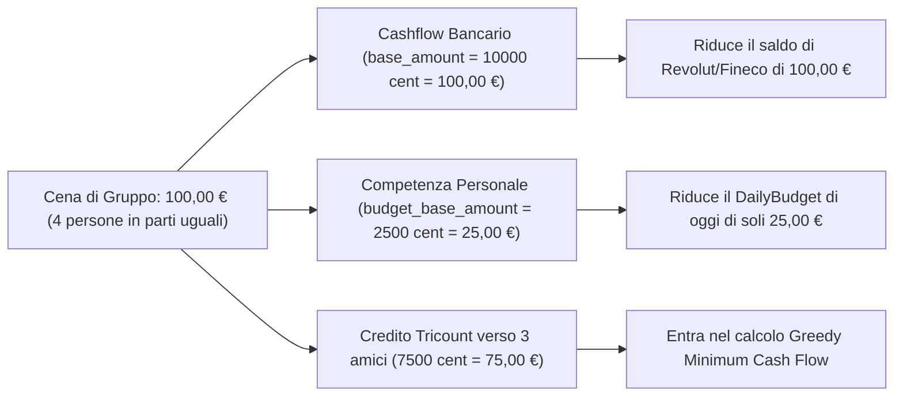
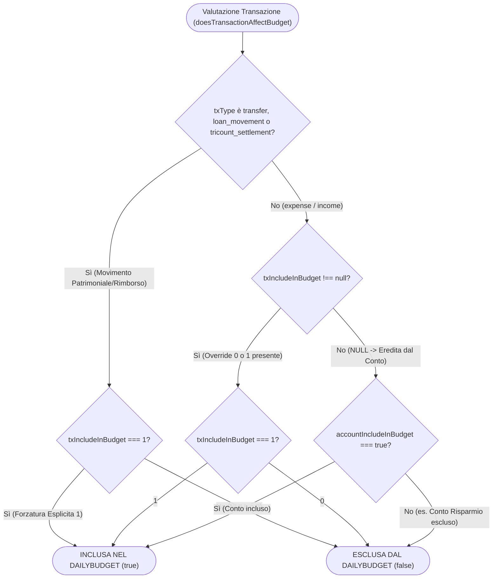
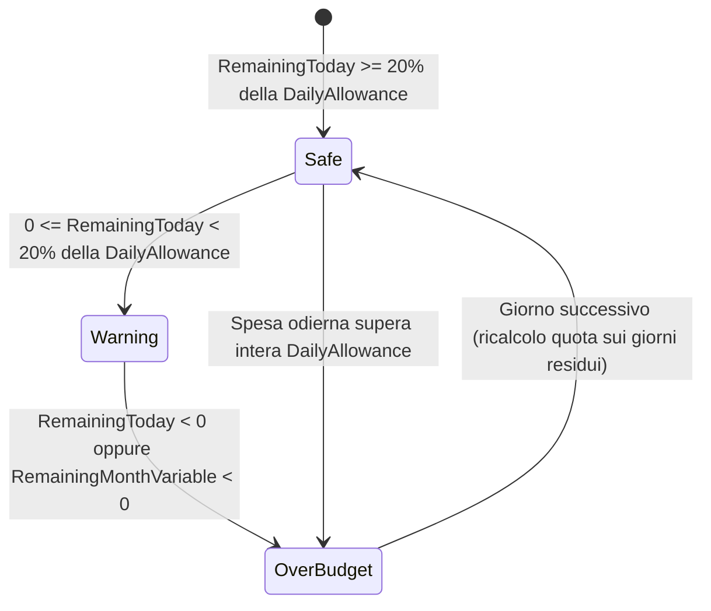
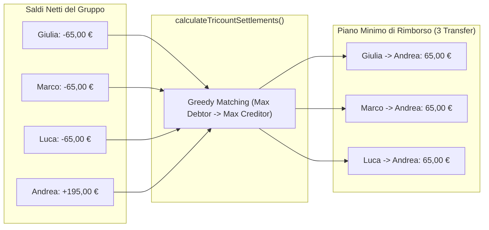

# Analisi del Prodotto & Regole di Business — DailyBudget

Questo documento descrive la logica finanziaria, gli invarianti contabili e i flussi funzionali di **DailyBudget**, implementati in [`@dailybudget/core`](../packages/core/src/index.ts).

---

## 1. Invariante Zero Floating-Point e Separazione Cashflow vs Competenza

### A. Rappresentazione Numerica
- **Valute Fiat**: tutti gli importi sono memorizzati e calcolati come **interi in centesimi (minor units)** (`12,50 €` = `1250`). Nessuna operazione contabile Fiat usa virgola mobile non arrotondata.
- **Criptovalute**: le quantità sono rappresentate come **stringhe decimali ad alta precisione** (es. `"0.04523100"`) per preservare fino a 8–18 decimali senza errori di rappresentazione IEEE 754.

### B. Cashflow Bancario (`base_amount`) vs Competenza di Budget (`budget_base_amount`)
Ogni transazione separa nettamente due grandezze:
1. **`base_amount`**: l'importo effettivo (convertito nella valuta base del workspace) che entra o esce dal saldo del conto bancario (`accounts.cached_balance`).
2. **`budget_base_amount`**: la quota parte di competenza personale che impatta il calcolo del **DailyBudget** e gli split di categoria (`transaction_splits`).

---

## 2. Gerarchia di Priorità sul Budget (`Transazione > Conto`)

La funzione [`doesTransactionAffectBudget`](../packages/core/src/index.ts) decide se una transazione impatta il calcolo del DailyBudget seguendo una gerarchia deterministica in cui l'override esplicito sulla transazione (`include_in_budget: 0 | 1`) vince sempre sul default del conto (`accounts.include_in_budget`).

---

## 3. Motore Matematico DailyBudget & Burn Rate Forecasting

Il motore [`calculateDailyBudget`](../packages/core/src/index.ts) isola le **Spese Fisse** (affitto, mutuo, utenze, abbonamenti fissi) dal **Pool Variabile** su cui l'utente ha controllo quotidiano:

1. **Pool Fisso Effettivo**:
   $$\text{EffectiveFixed} = \max(\text{FixedPlanned}, \text{FixedActual})$$
   *(Se una spesa fissa supera il preventivato, il pool variabile si riduce automaticamente per proteggere il target mensile).*
2. **Pool Variabile Mensile**:
   $$\text{VariablePool} = \text{MonthlyBudgetTarget} - \text{EffectiveFixed}$$
3. **Disponibilità Variabile ad Inizio Giornata**:
   $$\text{AvailableStartOfToday} = \text{VariablePool} - \text{VariableSpentBeforeToday}$$
4. **Quota Giornaliera Dinamica (`DailyAllowanceToday`)**:
   $$\text{DailyAllowanceToday} = \left\lfloor \frac{\text{AvailableStartOfToday}}{\text{DaysRemainingIncludingToday}} \right\rfloor$$
5. **Residuo di Oggi (`RemainingToday`)**:
   $$\text{RemainingToday} = \text{DailyAllowanceToday} - \text{VariableSpentToday}$$

---

## 4. Risolutore Debiti Tricount (Greedy Minimum Cash Flow)

Nei gruppi di spesa condivisa (`tricount_groups`), ogni spesa aggiorna il saldo netto (`netBalanceCents`) di ciascun partecipante:
- Chi paga matura un credito (`+group_amount`).
- Chi partecipa allo split (`equal`, `exact`, `percentage`, `shares`) matura un debito (`-owed_group_amount`), con distribuzione deterministica dei centesimi di resto tramite [`computeTricountExpenseSplits`](../packages/core/src/index.ts).

L'algoritmo [`calculateTricountSettlements`](../packages/core/src/index.ts) ordina debitori e creditori per importo decrescente e accoppia iterativamente il maggior debitore col maggior creditore, minimizzando il numero di transazioni di rimborso.

---

## 5. Motore Crypto Portfolio (Weighted Average Cost — WAC)

La funzione [`calculateCryptoAssetMetrics`](../packages/core/src/index.ts) processa cronologicamente le operazioni di ciascun asset (`crypto_transactions`):

| Tipo Operazione (`type`) | Effetto sulla Quantità (`totalQty`) | Effetto sul Cost Basis (`totalCostCents`) | Effetto sul Prezzo Medio di Carico (PMC / WAC) | Effetto sul P&L Realizzato |
| :--- | :--- | :--- | :--- | :--- |
| **`buy` / `transfer_in`** | $+\text{qty}$ | $+\text{round}(\text{qty} \times \text{price}) + \text{fee}$ | Ricalcolato sulla nuova media pesata | Nessuno |
| **`staking_reward`** | $+\text{qty}$ | $+0$ (costo zero) | **Si abbassa** (più unità allo stesso costo storico) | Nessuno |
| **`sell`** | $-\text{qty}$ | $-\text{round}(\text{PMC} \times \text{qty})$ | Invariato per le unità residue | $+(\text{Proceeds Netti} - \text{Costo Unità Vendute})$ |
| **`transfer_out`** | $-\text{qty}$ | $-\text{round}(\text{PMC} \times \text{qty})$ | Invariato per le unità residue | Nessuno |
